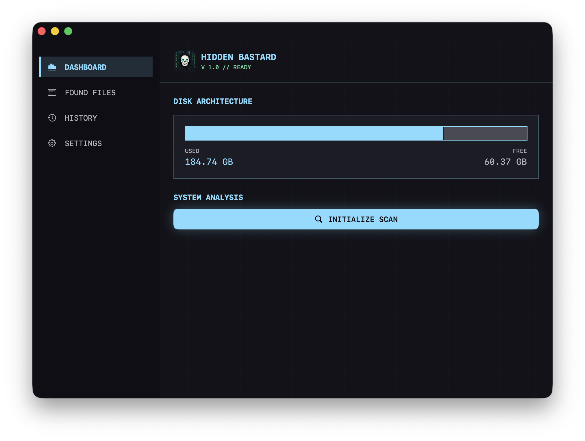
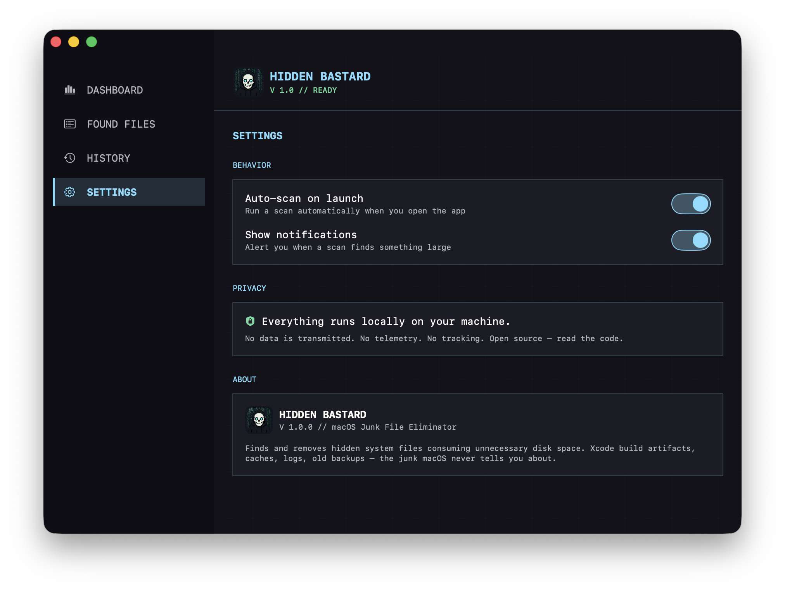

<p align="center">
  
</p>

# Hidden Bastard

**macOS Storage Discovery and Cleanup — v1.1**

Free. Open-source. No subscriptions. No telemetry. Built by [MDRN Corp](https://mdrn.app).

[](LICENSE)
[](https://github.com/ghostintheprompt/hidden-bastard/releases)
[](https://github.com/ghostintheprompt/hidden-bastard/releases)

---

## Find hidden storage. Understand it before cleanup.

Hidden Bastard scans known cleanup locations and discovers large folders across your home directory—including hidden dotfolders—and selected app-data locations. It explains what findings are likely for, distinguishes known caches from projects and application data, protects recognized credential paths, and moves only items you choose to Trash.

---

## Recent updates

- Broad discovery now includes hidden home folders (such as `.codex` and `.colima`), large user-data and app-data folders, Xcode/Simulator data, and installed apps.
- Findings show the path, size, item timestamp, likely purpose, and a review recommendation. Project markers, developer state, installed apps, and unknown data are not preselected.
- Large completed downloads are reported separately from known partial downloads.
- **SELECT SAFE ITEMS** only selects known regenerable caches with old timestamps and stale partial downloads. Trash contents still require an explicit choice.
- **EXPORT .MD** saves the current findings locally for a second opinion. It contains metadata, not file contents; recognized credential and browser-profile paths are redacted. Review project/client names before sharing externally.
- Build the macOS app with Apple's Command Line Tools; a full Xcode installation is not required.

---

## Screenshots




---

## What It Finds

| Category | What it is | Typical size |
|---|---|---|
| **Application Caches** | Browser, app, and system temp files | 2–15 GB |
| **Xcode DerivedData** | Build artifacts from every project you've touched | 10–30 GB |
| **iOS Backups** | Old iPhone/iPad local backups, never auto-deleted | 10–50 GB |
| **System Logs** | Crash reports, diagnostic logs, app logs from years ago | 500 MB–5 GB |
| **Developer Caches** | npm, Yarn, CocoaPods, Gradle, Homebrew downloads | 5–20 GB |
| **iOS Simulators** | Installed apps & data per Xcode simulator device (the big one) | 5–20 GB |
| **VS Code Storage** | Workspace storage, extension cache, logs | 1–5 GB |
| **Python Envs** | Virtualenvs and pyenv versions that outlived their projects | varies |
| **Incomplete Downloads** | Partial downloads that never finished | varies |
| **Trash** | Files already deleted but not yet freed from disk | varies |
| **Large App Data** *(broad discovery)* | Hidden tool data, VM/container disks, local AI models, project folders, and other large app data | varies |
| **Large Downloads** | Large completed downloads, kept separate from incomplete-download cleanup | varies |

Every result shows its full path, size, item timestamp, and a plain-English assessment of its likely purpose and relevance. Recent caches, development data, projects, installed apps, and unknown folders are not preselected. Items that are not protected can still be selected manually after review. Old, known regenerable caches and stale partial downloads are the only items eligible for automatic selection; **SELECT SAFE ITEMS** applies the same rule.

---

## Installation

### Download (Recommended)

1. Download `HiddenBastard.dmg` from [Releases](https://github.com/ghostintheprompt/hidden-bastard/releases)
2. Open the DMG, drag **Hidden Bastard** to Applications
3. **Right-click → Open** on first launch (required for unsigned apps — normal for open-source tools)
4. Scan

### Homebrew

```bash
brew install --cask hidden-bastard
```

### Build from Source

```bash
git clone https://github.com/ghostintheprompt/hidden-bastard
cd hidden-bastard
bash ./build_app.sh
```

The app is created at `build/HiddenBastard-CLT.app`. See [BUILD.md](BUILD.md) for DMG and signing instructions.

---

## Usage

1. Launch Hidden Bastard
2. Click **INITIALIZE SCAN** — scans known cleanup locations and performs broad discovery of hidden and large user folders
3. Review **FOUND FILES** — each item shows its path, purpose, size, and item timestamp
4. Select only items you have verified; protected credential and browser-profile paths cannot be selected
5. Optionally click **EXPORT .MD** to save a report locally; check names and paths before sharing it with an AI chatbot
6. Click **MOVE TO TRASH** — selected items are moved to Trash
7. Check **HISTORY** to see everything that's been moved

---

## Safety rules

Broad discovery surfaces unfamiliar folders rather than calling them junk. Documents, photos, project data, developer state, and installed apps are never auto-selected. Recognized password, keychain, browser-profile, and credential paths are blocked from selection. Recent timestamps are clues, not proof that something is in use or unused. Other review-only items can be selected manually after you verify them. Selected items are moved to **Trash**, not permanently deleted.

---

## Privacy & Security

Everything runs locally on your machine. No data leaves your computer. No analytics, no tracking, no telemetry. No network calls. Read the code — it's all here.

---

## Building a Release DMG

```bash
bash ./make_dmg.sh 1.1.0
```

Builds the app using the Command Line Tools, wraps it in a DMG with an Applications symlink, and outputs `build/HiddenBastard-1.1.0.dmg`. Existing files in `build/` are preserved.

---

## System Requirements

- macOS 13.0 Ventura or later
- No special permissions required at install — app requests access at scan time

---

## Real-World Results

**Developer (first scan):** 20–70 GB freed — Xcode artifacts, npm caches, old simulator data  
**Casual user:** 3–10 GB — browser cache, app caches, system logs  
**Long-time Mac user:** 50–100 GB — iOS backups from old devices, years of accumulated cache

---

## Why It Exists

macOS Storage Management shows you large files you already know about. It doesn't touch hidden junk. CleanMyMac costs $40/year, is closed source, and upsells constantly.

Hidden Bastard is free, open-source, does one thing, and does it well.

---

## License

MIT — see [LICENSE](LICENSE)

---

Built by **MDRN Corp** — [ghostintheprompt.com](https://ghostintheprompt.com/articles/hidden-bastard)

*Your Mac. Your space. No junk.*
